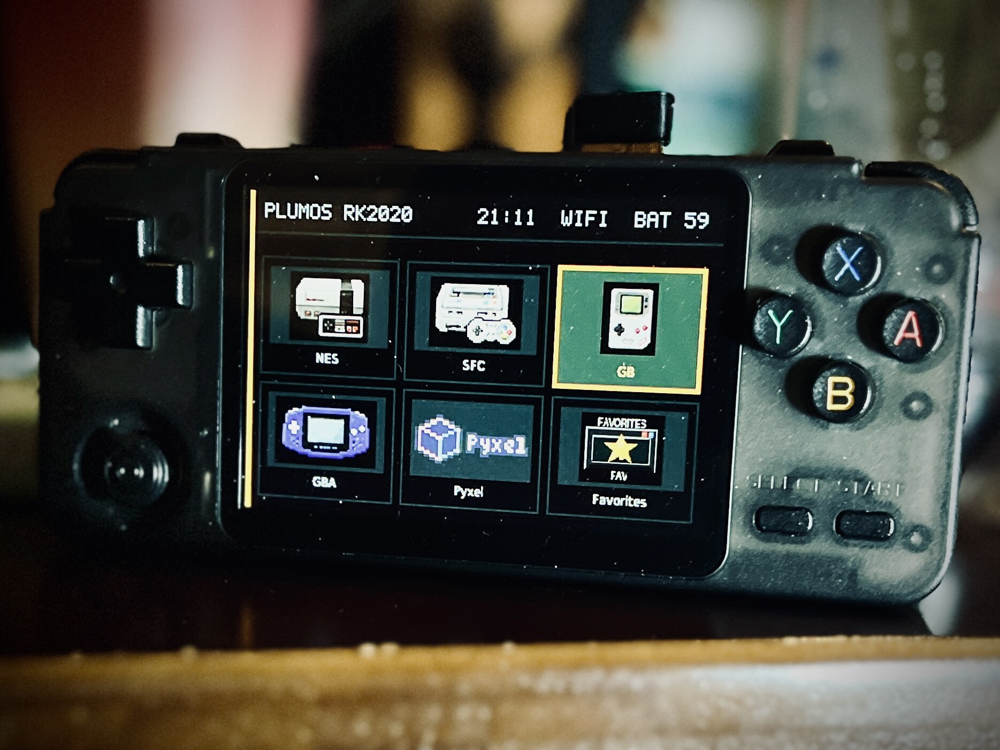
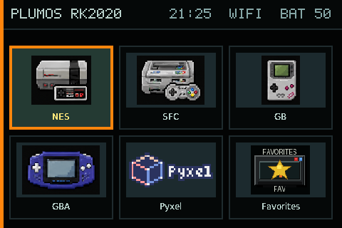
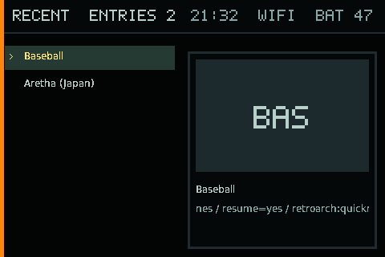
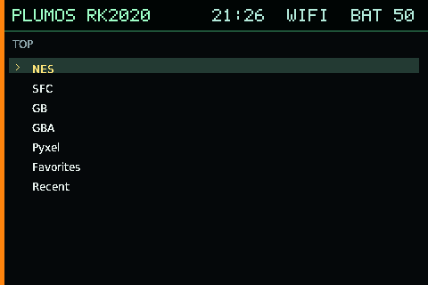

# plumOS RK2020

<p align="center">
  
</p>

<table>
  <tr>
    <td width="33%" align="center">
      <br>
      <sub>グラフィックモード</sub>
    </td>
    <td width="33%" align="center">
      <br>
      <sub>ギャラリーモード</sub>
    </td>
    <td width="33%" align="center">
      <br>
      <sub>テキストモード</sub>
    </td>
  </tr>
</table>

plumOS RK2020は、RK3326搭載RK2020専用のSDカード起動Linuxディストリビューション
です。stock由来のRockchip boot、kernel、device tree、module、firmwareを
ハードウェア互換層として維持し、frontend、emulator、Apps、設定、電源管理、
update機構をplumOSで管理します。

## ドキュメント

利用者向けと開発者向けを分離しています。公開索引、ユーザー向け取扱説明書、移植計画は
英語版と日本語版を用意し、日付付き実機検証logは作業時の原文を保持します。

- [ドキュメント索引](docs/README.ja.md)
- [ユーザー向け取扱説明書](docs/user/README.ja.md)
- [RK2020の操作とエミュレータhotkey](docs/user/operation.ja.md)
- [対応システム・ROMフォルダ・core一覧](docs/user/supported-systems.ja.md)
- [SDカードと再書き込み](docs/user/storage-and-reimaging.ja.md)
- [リリース手順](docs/developer/release-process.ja.md)
- [English project overview](README.md)

RK2020は他のplumOS機種より物理ボタンが少なく、standalone emulatorごとにmenuや
終了操作が異なります。ゲームを始める前に操作ガイドを確認してください。

## ディストリビューション構成

- RK2020専用SDカードイメージ。本体内蔵ストレージへのinstallは不要
- stock Linux 4.4.189 kernelと対応するRK2020 hardware runtime
- グラフィック、ギャラリー、テキスト表示に対応するplumOS frontend
- RetroArch、PicoArch、standalone emulator、Apps、Pyxel、PortMaster
- ROM、BIOS、save、screenshot、update用FAT user volume
- Wi-Fi、SFTPファイル転送、scraping、sleep、安全なshutdown

ROM、ゲーム機固有の有償・著作権保護BIOS、および製品版PICO-8 runtimeは同梱
しません。利用権を持つデータだけを用意してください。

## 開発

同じRK3326を使うPixel2の実装履歴を出発点にしていますが、Pixel2の検証結果を
RK2020の合格として扱いません。boot、display、input、audio、network、power、
各emulator routeをRK2020実機で個別に検証します。詳細は
[移植計画](docs/rk2020-porting-plan.ja.md)と[TODO](TODO.md)を参照してください。

Docker buildの入口は次のcommandです。

```sh
./scripts/docker-build.sh --help
```

## ライセンス

plumOS作成部分には[MIT License](LICENSE)を適用します。stock/vendor boot materialと
第三者componentは元の条件を維持します。詳細は[NOTICE.md](NOTICE.md)と
[THIRD_PARTY_NOTICES日本語版](THIRD_PARTY_NOTICES.ja.md)を参照してください。

RK2020の最初の正式releaseはversion **0.1.0**です。SD imageとsource archiveの
file名は[リリース手順](docs/developer/release-process.ja.md)で定義しています。
