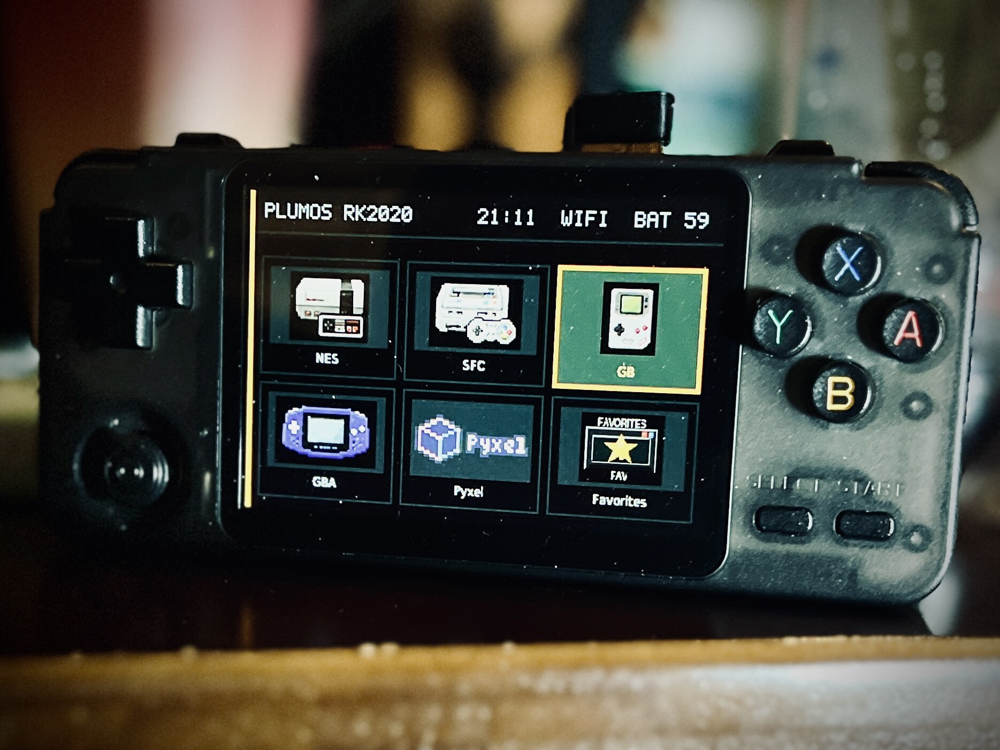
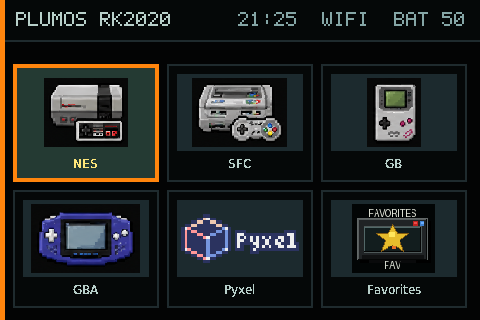
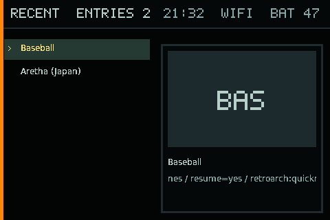
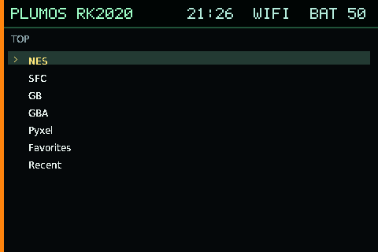

# plumOS RK2020

<p align="center">
  
</p>

<table>
  <tr>
    <td width="33%" align="center">
      <br>
      <sub>Graphic mode</sub>
    </td>
    <td width="33%" align="center">
      <br>
      <sub>Gallery mode</sub>
    </td>
    <td width="33%" align="center">
      <br>
      <sub>Text mode</sub>
    </td>
  </tr>
</table>

plumOS RK2020 is an SD-card Linux distribution for the RK3326-based RK2020
handheld. It retains the stock Rockchip boot, kernel, device tree, modules, and
firmware as the hardware compatibility layer, while plumOS supplies the
frontend, emulators, applications, settings, power handling, and update flow.

## Documentation

User and developer material is separated. The public indexes, user manual, and
porting plan are provided in both English and Japanese; dated validation logs
retain their original working language.

- [Documentation index](docs/README.md)
- [User manual](docs/user/README.md)
- [RK2020 controls and emulator hotkeys](docs/user/operation.md)
- [Supported systems, ROM directories, and cores](docs/user/supported-systems.md)
- [SD storage and reimaging](docs/user/storage-and-reimaging.md)
- [日本語版](README.ja.md)

The RK2020 has fewer physical buttons than several other plumOS devices. Read
the controls guide before using standalone emulators; menu and exit operations
are intentionally documented per emulator.

## Distribution layout

- RK2020-specific SD-card image; no installation to internal storage
- stock Linux 4.4.189 kernel and matching RK2020 hardware runtime
- plumOS frontend with graphic, gallery, and text views
- RetroArch, PicoArch, standalone emulators, Apps, Pyxel, and PortMaster
- FAT user volume for ROMs, BIOS files, saves, screenshots, and updates
- Wi-Fi networking, SFTP file transfer, scraping, sleep, and safe shutdown

ROMs, proprietary game BIOS files, and the commercial PICO-8 runtime are not
included. Supply only data that you are legally entitled to use.

## Development

Pixel2 implementation history was used as a starting reference because both
devices use RK3326, but Pixel2 evidence never counts as RK2020 acceptance.
Boot, display, input, audio, network, power, and every emulator route are
validated independently on RK2020 hardware. See the
[porting plan](docs/rk2020-porting-plan.md) and [TODO](TODO.md).

The Docker build entry point is:

```sh
./scripts/docker-build.sh --help
```

## License

plumOS-authored material is [MIT licensed](LICENSE). Stock/vendor boot material
and third-party components retain their original terms. See [NOTICE.md](NOTICE.md)
and [THIRD_PARTY_NOTICES.md](THIRD_PARTY_NOTICES.md).
